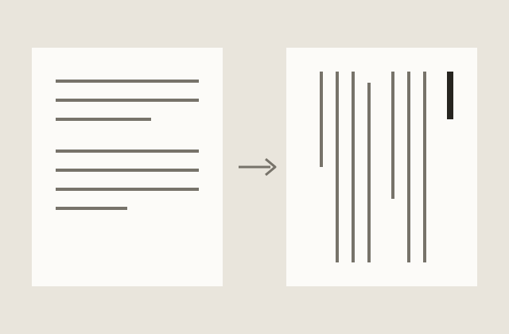

この頁は、原稿に使える記法をひととおり使って組んだ見本である。原稿はリポジトリの src/posts/example/index.md にあるので、プレビューと見比べると、どう書けばどう組まれるかがわかる。

## 文字の飾り

読みにくい漢字には、{薔薇|ばら}のように語全体へ読みを振る。{東京|とう|きょう}のように、一字ずつ振ることもできる。縦組で数字を立てたいときは、^10^月^24^日のように縦中横にする。三字までなら一字分の幅に収まる。強調したい語には*傍点*を打つ。

## 英字と数字

ＣＳＳのような頭字語は、全角で書くと縦組で立つ。横組で開くと半角に戻る。Eleventyのような単語は半角で書くと、縦組では横に倒れる。和文と英字のあいだに空白を挟む必要はなく、四分の空きは組版で自動的に付く。

## 段落と場面

段落は空行で区切る。
段落の中で改行しても、
表示の上では一続きの段落になる。

---

場面が変わるところには、横線を一本引く。画面の上では＊の印になる。

## 引用

引用は二字下げ、一回り小さな文字で組む。出典は最後の行に書き、行の終わりに寄せる。

> ゆく河の流れは絶えずして、しかももとの水にあらず。
> ――鴨長明『方丈記』

## 箇条書き

記号の後ろに空きを一つ置くと、箇条書きになる。

- 縦組でも横組でも、記号は中黒になる。
- 項目の頭を字下げすると、入れ子になる。
  - 入れ子の項目は、親の本文の頭に揃う。

番号付きの箇条書きは、縦組では漢数字、横組では算用数字になる。

1. 番号は一つめの項目の数から順に振る。
1. 同じ数を並べて書いても、画面の上では連番になる。

1945\. のように数字と点で始まる段落は、点の前にバックスラッシュ（逆斜線 \）を置くと、箇条書きにならない。

## 脚注と図

注を付けたい語の直後に [^1] と書き、行頭から [^1]: 注の文 で中身を書く。本文には[^sample]注番号だけが付き、説明や参考先のリンク[^site]は頁の末尾にまとまる。注の中では[リンク記法](https://www.11ty.dev/)や URL の直接記入も使える。

[^sample]: 注の中身は空行を挟むか、次の注の手前まで書ける。
[^site]: https://www.11ty.dev/

図は、本文の中では番号だけを示し、押すと開く。画像は執筆画面の本文欄にドラッグ＆ドロップするか貼り付けると、記事のフォルダに保存される。
